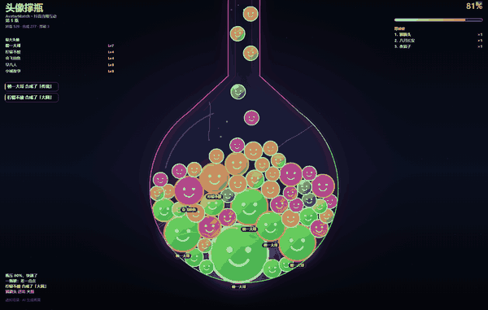
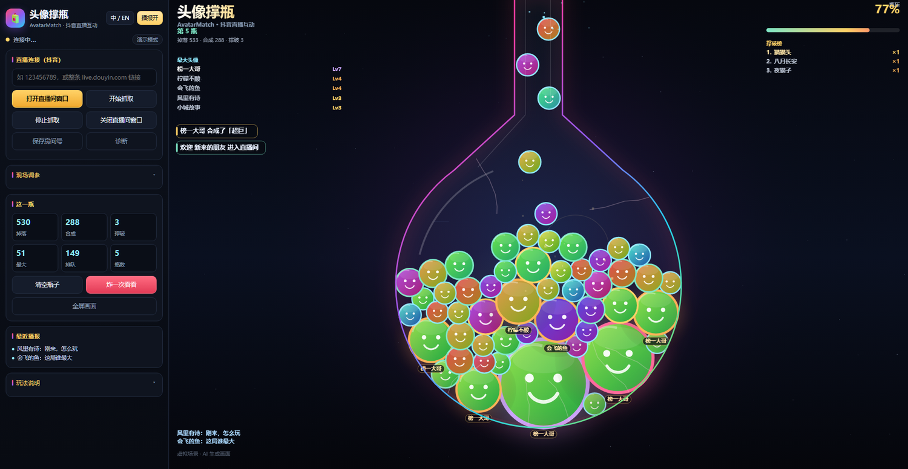
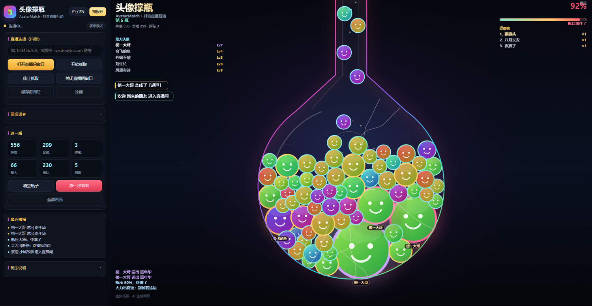
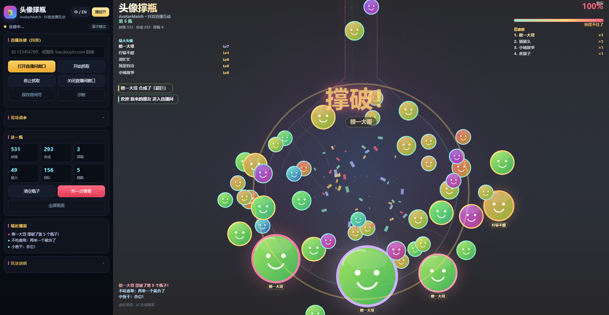
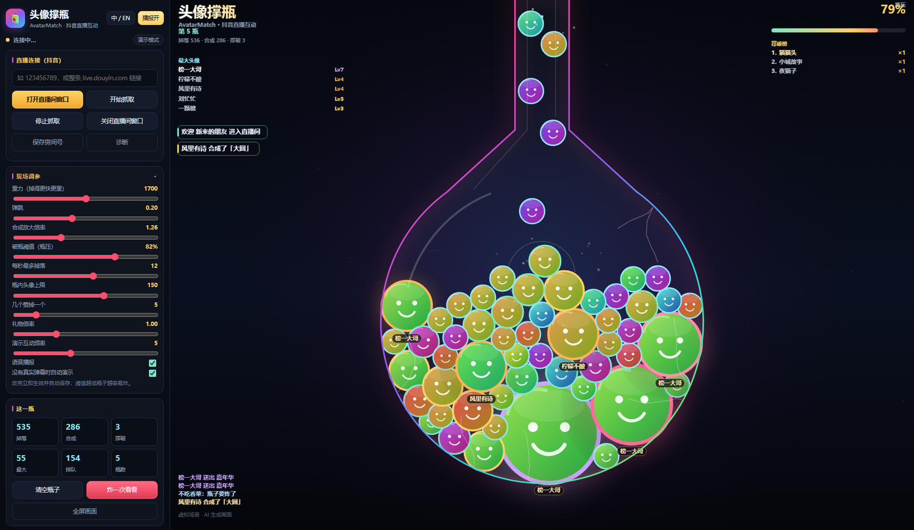

# 头像撑瓶 · AvatarMatch

**直播间里的头像撑瓶**：点赞就掉头像，评论掉更多，同一观众的**同尺寸头像撞在一起就变大**，
一路合到把**玻璃瓶撑爆**——炸开、播报、换新瓶，撑破的人进「撑破榜」。

> 一个可以无人值守跑起来的抖音直播互动玩法：不用主播出镜，画面自己就有戏。
> 中文 · [English](#english) · [玩法设计](docs/方案-头像撑瓶.md) · [更新日志](CHANGELOG.md)



<p align="center">
  
  
  
  
  
</p>

---

## 这是什么

一款「**合成 + 物理堆积**」的直播互动游戏：

- 观众的头像从瓶口掉进一个**圆形玻璃瓶**，头像越掉越多；
- **同一个观众、同一尺寸**的两个头像碰到一起，就合成一个**更大**的；
- 大一级再撞、再合，直到瓶子被撑满；
- **瓶压到 100% 就炸**——玻璃碎裂、头像四散、语音播报「谁撑破了瓶子」，然后立刻换一个新瓶从头开始。

爽点很直接：**全场的互动都在同一个瓶子里变成体积**，谁合出了巨物、谁最后把瓶子撑破，画面上一眼就能看见。

- 🖼️ **真实头像**：头像就是观众本人，认脸即认人
- 🔥 **互动越多掉得越多**：点赞、评论、关注、分享、礼物全部换成掉落
- 🧩 **合成有策略**：同一个人的同尺寸头像才能合，榜单大哥送一个大礼物能直接起飞
- 🏆 **撑破榜**：谁撑破过几次，写在右上角，也存进本地榜单
- 🛠️ **现场可调**：重力、弹跳、合成倍率、破瓶阈值、掉落速度全部滑杆实时生效
- 📱 **横屏直出**：16:9 构图，OBS 窗口采集就能开播
- 🌐 **中英双语 + 语音播报**

## 快速开始

开箱即用，**不需要再下载别的项目**——抖音数据桥已经内置在 `bridge/` 里了。

| 依赖 | 是否必需 | 说明 |
|---|---|---|
| **Python 3.9+** | 必需 | 启动本地服务和桌面窗口 |
| **pywebview** | 桌面窗口需要 | `pip install pywebview`；纯浏览器预览不用 |
| **Node.js 18+** | 接真实弹幕需要 | 跑内置数据桥；只玩演示模式不用 |
| WebView2 Runtime | Windows 桌面窗口需要 | Win10/11 一般自带 |

```bash
pip install pywebview     # 只有用桌面窗口才需要；纯浏览器预览可以跳过
```

```bat
:: 双击运行（会打开桌面窗口）
start.bat
```

不想开桌面窗口？也可以纯浏览器预览：

```bash
python -m http.server 8090
# 打开 http://127.0.0.1:8090/index.html?demo=1
```

`?demo=1` = 强制演示模式：不连接任何数据桥，本地自动生成模拟观众，适合先看效果、录屏、截图。

### 界面

| 直播画面（横屏 16:9） | 快撑破了 |
|---|---|
|  |  |

| 撑破瞬间 | 现场调参 |
|---|---|
|  |  |

## 玩法规则

| 互动 | 效果 |
|---|---|
| **进场** | 掉 1 个头像（首次进场有欢迎播报） |
| **点赞** | 每 5 个赞掉 1 个头像（余数累计，连点不会浪费） |
| **评论** | 掉 2 个，弹幕内容进滚动播报（不逐条朗读） |
| **关注 / 分享** | 掉 3 个 |
| **礼物** | 小心心/棒棒糖：3 个 + 直接送一个 2 级；玫瑰/啤酒：6 个 + 2 级；火箭/嘉年华：12 个 + 一个 3 级 |
| **连击** | 同一个人 3 秒内连续互动，每次额外 +1（最多 +5，点赞/进场不叠） |
| **合成** | 同一个人 + 同一尺寸相撞 → 升一级，半径 ×1.26（面积 ×1.59，所以合成能泄压） |
| **撑破** | 瓶压到 100% 就炸；碎屏 1.35 秒后换新瓶，**头像总面积最大的人**记一次「撑破」 |
| **清屏** | 左侧「清空瓶子」一键移除瓶内所有头像（换场、画面太乱时用） |

### 现场调参（改完立即生效，自动保存）

| 参数 | 默认 | 作用 |
|---|---|---|
| 重力 | 1700 | 600–2800。越大掉得越快、堆得越实 |
| 弹跳 | 0.20 | 0–0.5。越小越"闷"，越大越活泼 |
| 合成放大倍率 | 1.26 | 1.10–1.60。越大合成后跳得越猛 |
| 破瓶阈值（瓶压） | 82% | 50–95%。越低越容易炸，节奏越快 |
| 每秒最多掉落 | 12 | 2–20。瓶口吞吐上限，决定"排队"长度 |
| 瓶内头像上限 | 150 | 30–220。到顶后不再放行，压力转到"瓶口堵塞" |
| 几个赞掉一个 | 5 | 1–30。点赞洪水太猛时调大 |
| 礼物倍率 | 1.00 | 0.2–3。整场礼物效果的统一倍率 |
| 演示互动频率 | 5 | 1–10 次/秒。只影响 `?demo=1` 的模拟观众 |

> 想让画面更"炸"：重力 2100 + 弹跳 0.3 + 破瓶阈值 70%；想耐看、让大物多活一会儿：重力 1400 + 阈值 90%。

## 接入真实抖音弹幕

**数据桥已内置**（`bridge/`，Node.js，零 npm 依赖），只需要 Node.js 18+：

1. 填**直播间号或整条链接**（如 `123456789`），回车保存；
2. 点 **「打开直播间窗口」**——用 Edge/Chrome 开一个带远程调试端口的直播窗口，扫码登录抖音；
3. 点 **「开始抓取」**——启动 `bridge/douyin-bridge.mjs`，页面自动连上 `ws://127.0.0.1:8765`，真实昵称/头像/点赞/评论/礼物就进来了。

**关于内置的 bridge/**

| | |
|---|---|
| 来源 | 开源项目「头像打印机」[rhfbgfgfdg999999/3d-printer-live](https://github.com/rhfbgfgfdg999999/3d-printer-live)（作者 VESAM9J / 志哥AI，MIT） |
| 许可 | **MIT**，版权归原作者，见 [bridge/LICENSE](bridge/LICENSE)；本仓库**原样内置、未修改** |
| 版本 | 上游 commit `c3a21d4`（2026-11-01） |
| 只含 | `douyin-bridge.mjs`（采集器）+ `bridge-ws.mjs`（内置 WS 服务），仅用 Node 内置模块 |

想换成自己的采集器：把 `MATCH_BRIDGE_DIR`（或兼容的 `ARENA_BRIDGE_DIR`）指向该目录即可。
想更新上游新版：见 [bridge/README.md](bridge/README.md)。

**接了但没反应？** 点页面上的 **「诊断」**：它会显示数据桥状态、直播间窗口里的标签页 URL、采集器进程、以及采集器日志最后几行（日志在 `bridge/desktop-bridge.log`）。常见原因见 [FAQ](#faq)。

## 技术架构

纯前端 Canvas 2D + 一个很小的 Python 启动器，没有构建步骤、没有 npm 依赖、没有后端服务。

```
直播间 (抖音)
   │  弹幕/点赞/礼物/进场
   ▼
数据桥 bridge/（内置，可替换）──WebSocket(8765)──►  match-bridge.mjs   事件接入 + 本地演示模拟器
                                                  │
                                                  ▼
                                          match-engine.mjs       纯逻辑：掉落 / 物理 / 合成 / 撑破
                                            │        │
                          match-leaderboard.mjs ─┘    └─► match-render.mjs   Canvas 渲染（玻璃瓶 + HUD）
                          （撑破榜 / localStorage）        match-speech.mjs    TTS 播报
                                                           │
                                                  index.html ──► launch.py（本地服务 + WebView2 窗口）
```

| 文件 | 作用 |
|---|---|
| `index.html` | 页面：瓶口画面、直播面板、撑破榜、现场调参、中/EN |
| `match-engine.mjs` | 规则与物理（掉落、重力、瓶壁、合成、瓶压、撑破、换瓶） |
| `match-render.mjs` | Canvas 渲染，画面自带全部直播信息（可单独给 OBS 采集） |
| `match-leaderboard.mjs` | 撑破榜（localStorage，脏数据兜底） |
| `match-settings.mjs` | 参数默认值 + 越界校验 + 调参面板 |
| `match-speech.mjs` | 欢迎 / 合成 / 大礼物 / 瓶压告急 / 撑破播报（浏览器 TTS） |
| `match-i18n.mjs` | 中英文案一张表（不复制第二份 HTML） |
| `match-bridge.mjs` | WebSocket 接入 + 数据桥探测 + 本地演示模拟器 |
| `bridge/` | **内置的抖音数据桥**（上游 MIT 原样内置，见 [bridge/README.md](bridge/README.md)） |
| `launch.py` | 本地 HTTP 服务（钉死 MIME）+ WebView2 窗口 + 数据桥管理接口 |
| `start.bat` | Windows 一键启动 |

## 为什么这样设计

几个反直觉但关键的取舍，都写成了可单测的纯逻辑：

1. **只有"同一个人 + 同一尺寸"才能合**
   如果任意同尺寸都能合，画面很快变成几个巨物互撞，认不出是谁；现在每个观众滚自己的雪球，
   名字牌和大头像都对应到具体的人，"榜一大哥合出了超巨"才有意义。
2. **瓶口是真的窄，排队是玩法的一部分**
   瓶口每秒只能放行 ~12 个头像，互动再猛也只能排队。队列不直接算瓶压（空瓶不会被刷屏"炸掉"），
   但当瓶内头像到一半以上时，堵在瓶口的人会顶起瓶压——**"口子堵死了"也是撑破的一种方式**。
3. **瓶身是"高度场"，不是圆 + 矩形的拼装**
   早先用"圆 SDF ∪ 瓶颈矩形"会在肩膀处形成两个凹角，头像会永远卡在肩上掉不下来。
   现在每一层 y 有一个允许半宽 W(y)，斜肩收在圆瓶内部，没有接缝、没有凹角。
4. **撑破算给"头像总面积最大的人"**
   最后一击很难判定（合成、弹跳、挤压都可能触发），总面积最大的人最符合观众直觉，
   也避免了"小号捡漏"。
5. **只播大事，不逐条念弹幕**
   进场、大合成、大礼物、瓶压告急、撑破、换瓶才播；逐条念弹幕又吵又踩平台"第三方朗读"的归责线。
6. **合成会损失面积（×1.59 < ×2）**
   这样"合得多"能缓解瓶压，而不是单纯加速爆炸；同时大物也不会无限滚雪球。

## 测试

```powershell
node --test "match-*.test.mjs"     # 45 个用例：掉落/合成/瓶压/撑破/物理/榜单/设置/文案/渲染/演示
python test_launch_windows.py      # 30 个用例：启动器/MIME/服务/内置数据桥/窗口尺寸/进程清理/诊断
```

CI 配置在 [.github/workflows/test.yml](.github/workflows/test.yml)（Windows runner，和实际运行环境一致）。

## FAQ

**Q：打开是空的？**
用 `?demo=1` 预览；正常启动时如果连不上数据桥会自动进演示模式，几秒后就有头像掉下来。

**Q：瓶子一直不炸？**
检查破瓶阈值（默认 82%）和瓶内上限；互动太少时瓶压涨得慢。演示模式可以把「演示互动频率」拉到 8–10。

**Q：接了数据桥，页面显示"已连接"但一条弹幕都没有？**
点「诊断」看日志最后几行：
- 反复显示「独立直播窗口未就绪」→ 有个旧的采集器在 8765 空跑，先停止抓取或结束那个 node 进程；
- 标签页 URL 不是 `live.douyin.com/房间号` → 直播间没登录/没进直播间；
- 房间号不是正在直播的那个 → 未开播/回放没有弹幕协议帧。

**Q：关掉程序后，直播间窗口关了又自己弹出来？**
旧版本退出时没结束采集器（node）进程，它变成孤儿后找不到直播间标签页，就会自动重开窗口。
现在关程序会自动结束采集器并关闭直播间窗口；如果遇到旧版本残留，点一次「停止抓取」（会顺手清理）。

**Q：能换成我的头像/背景/玻璃瓶吗？**
可以，渲染全在 `match-render.mjs`：瓶身轮廓、配色、粒子、HUD 都在这一层，改完刷新即可。

**Q：手机能看吗？**
页面是响应式的，但本游戏按横屏 16:9 设计；手机上建议横屏观看。

## 合规与免责

- 本仓库**不含**抖音协议抓取代码，真实弹幕链路依赖内置的开源数据桥，仅建议用于**自己的直播间**做自播测试。
- 所有平台（抖音/快手/小红书/TikTok）都禁止"无人直播、录播、假互动"。请勿用本程序伪造观众或假装实时互动；演示模式的模拟观众**只用于本地预览和录屏**，正式开播请关闭。
- 画面内已常驻「虚拟场景 · AI 生成画面」标识；每场开播请重新声明。
- 商用请走「直播小玩法」官方通道；礼物只做"更快更炫"，不涉及抽奖、盲盒、倍率或随机数值。
- 使用本程序产生的任何平台处罚、账号风险由使用者自行承担。

## 二次开发 · 做你自己的直播游戏

整个仓库就是一套"抖音直播互动游戏"的底座：`bridge/` 管数据、`match-engine.mjs` 管规则、
`match-render.mjs` 管画面、`launch.py` 管启动。换掉规则和画面就是另一个游戏。

- 单测直接照 `match-engine.test.mjs` 的写法：纯逻辑 + 固定随机种子，不依赖浏览器。
- 想调画面：`WORLD`（瓶身几何）和 `match-render.mjs` 的 `#drawBottle*` / `#drawHud`。
- 想调经济：`match-engine.mjs` 的 `feed()` 与 `MATCH_DEFAULTS`。

## Roadmap

- [ ] 瓶子皮肤的裂纹/碎玻璃更细（按压力分段）
- [ ] 撑破回放（最后 3 秒慢动作）
- [ ] 官方「直播小玩法」接入示例
- [ ] macOS / Linux 启动器

## 作者 / 联系

- 作者：**salmjohn**
- GitHub：[@abdusalam1](https://github.com/abdusalam1)
- 邮箱：salmjohnn@outlook.com

## 致谢

- **头像打印机**（作者 VESAM9J / 志哥AI，MIT）：[rhfbgfgfdg999999/3d-printer-live](https://github.com/rhfbgfgfdg999999/3d-printer-live) —— 抖音弹幕采集链路，已按 MIT 许可**原样内置**在 [bridge/](bridge/)（保留原作者版权声明，未修改）。
- **AvatarArena（头像大乱斗）**——本项目的架构底座：启动器、单页结构、测试组织、演示模式都沿用它的约定。
- 视觉参考：`matchgame.mp4`（圆瓶 + 瓶颈 + 从上面掉落的合成玩法）。

## License

本仓库代码 [MIT](LICENSE) © 2026 salmjohn。
`bridge/` 目录来自上游项目，同样为 MIT，版权归原作者 志哥AI，见 [bridge/LICENSE](bridge/LICENSE)。

---

<a id="english"></a>
## English

**AvatarMatch** — an interactive LIVE game for Douyin / TikTok. Viewers' avatars drop into a neon
glass bottle; **two avatars of the same viewer at the same size merge into a bigger one**; merge again
and again until the bottle is packed — then it **bursts**, the breaker is announced and the board is
reset.

- Zero build step: Python launcher + plain ES modules + Canvas 2D.
- `start.bat` opens the 16:9 desktop window; or `python -m http.server 8090` and open `index.html?demo=1`.
- Live data: a Douyin bridge is **bundled** in `bridge/` (vendored unmodified from the MIT-licensed
  Avatar Printer project) — just needs Node.js 18+.
- Interaction map: join 1 drop · every 5 likes 1 drop · comment 2 · follow/share 3 · gifts 3/6/12 plus
  a free Lv.2–3 avatar · same-viewer combo adds up to +5.
- Live tuning sliders (gravity, bounce, merge growth, burst threshold, drop rate, caps, gift multiplier).
- Tests: `node --test "match-*.test.mjs"` (45) and `python test_launch_windows.py` (30).
- Compliance: no fake interaction, no lottery/random rewards; use the official LIVE mini-game channel for
  commercial streaming.

Design notes (Chinese): [docs/方案-头像撑瓶.md](docs/方案-头像撑瓶.md)
